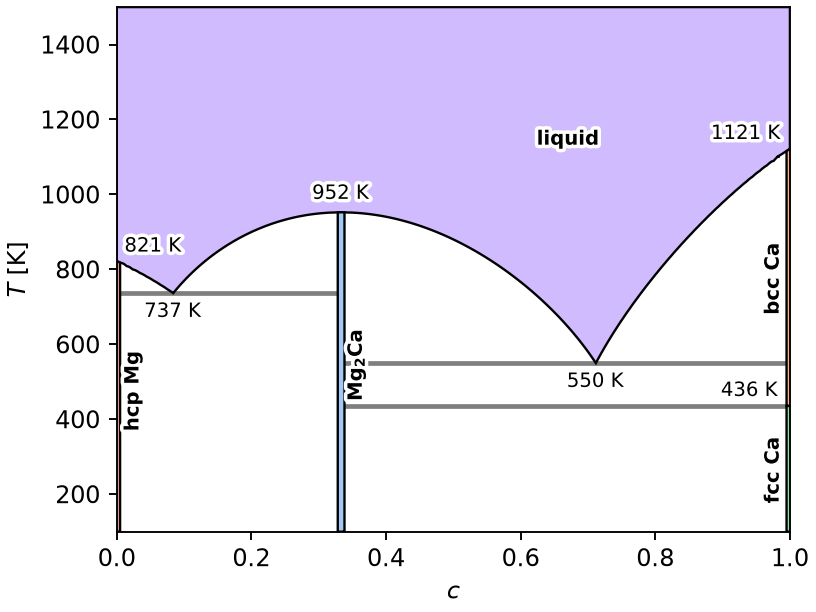
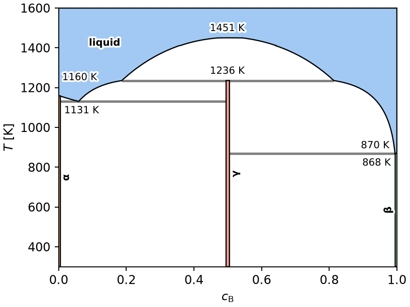
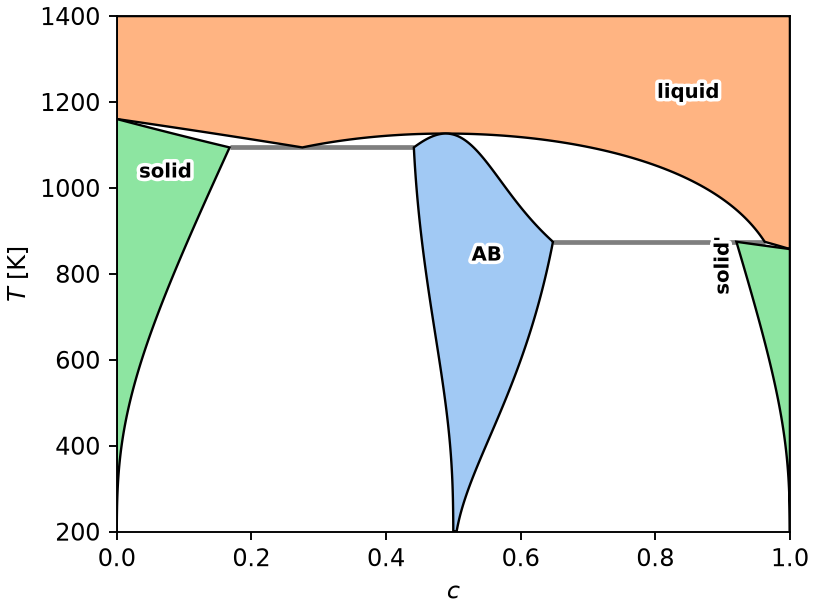
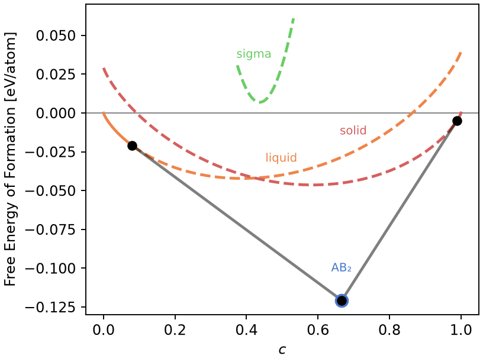
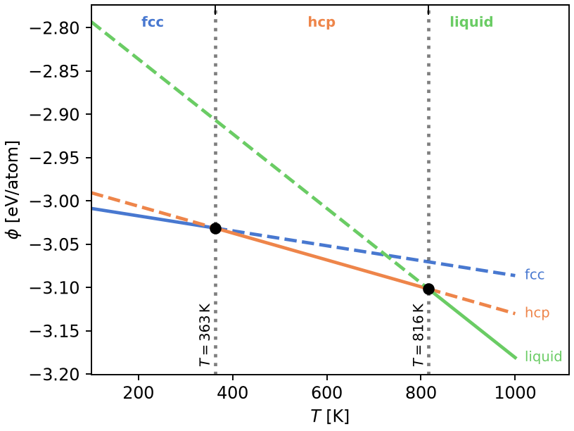
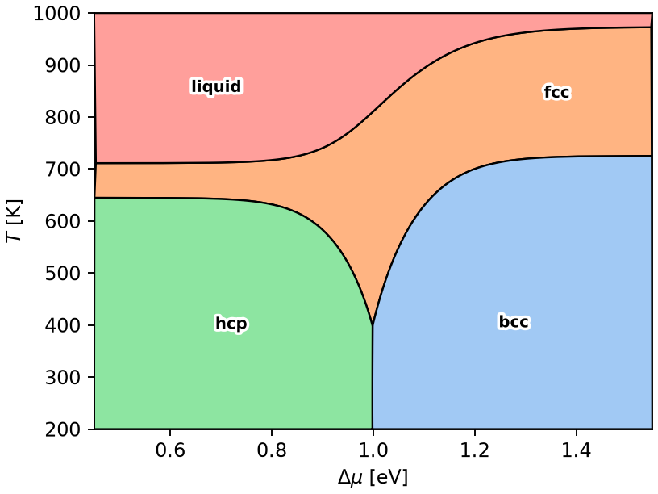
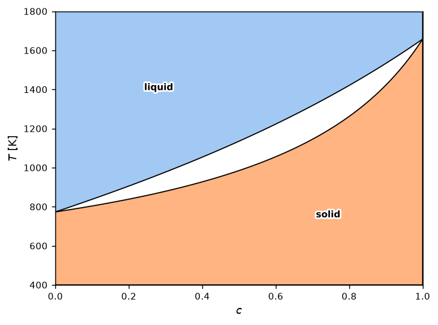

[](https://pypi.org/project/landau/)
[](https://doi.org/10.5281/zenodo.15513439)
[](https://landau.readthedocs.io/en/latest/?badge=latest)
[](https://deepwiki.com/eisenforschung/landau)

# landau.py

A library to calculate thermodynamic equilibria and plot phase diagrams of
binary alloys in the (semi-)grand ensemble.

You supply a free energy model for each phase — analytic toy models,
CALPHAD-style parametrizations, or interpolations of computed free energy data —
and landau finds the stable phases, refines the phase boundaries and draws the
diagram.

<table>
<tr>
<td width="33%" valign="top">
<a href="https://landau.readthedocs.io/en/latest/notebooks/MgCa/MgCa.html"></a><br>
<a href="https://landau.readthedocs.io/en/latest/notebooks/MgCa/MgCa.html"><b>Mg–Ca worked example</b></a><br>
A real system, from free energies of a machine learning potential.
</td>
<td width="33%" valign="top">
<a href="https://landau.readthedocs.io/en/latest/notebooks/TransitionTemperatures.html"></a><br>
<a href="https://landau.readthedocs.io/en/latest/notebooks/TransitionTemperatures.html"><b>Transition temperatures</b></a><br>
Three-phase reactions and congruent points, solved and labelled.
</td>
<td width="33%" valign="top">
<a href="https://landau.readthedocs.io/en/latest/notebooks/PointDefects.html"></a><br>
<a href="https://landau.readthedocs.io/en/latest/notebooks/PointDefects.html"><b>Point defects</b></a><br>
Off-stoichiometry of an ordered compound from point defect energies.
</td>
</tr>
<tr>
<td width="33%" valign="top">
<a href="https://landau.readthedocs.io/en/latest/notebooks/ExcessFreeEnergy.html"></a><br>
<a href="https://landau.readthedocs.io/en/latest/notebooks/ExcessFreeEnergy.html"><b>Excess free energy</b></a><br>
The free energy curves and common tangents behind a diagram.
</td>
<td width="33%" valign="top">
<a href="https://landau.readthedocs.io/en/latest/notebooks/Basics.html"></a><br>
<a href="https://landau.readthedocs.io/en/latest/notebooks/Basics.html"><b>Basics</b></a><br>
Phases compete through their semi-grand potential.
</td>
<td width="33%" valign="top">
<a href="https://landau.readthedocs.io/en/latest/notebooks/PlotGallery.html"></a><br>
<a href="https://landau.readthedocs.io/en/latest/notebooks/PlotGallery.html"><b>Plot gallery</b></a><br>
Every plot function, including diagrams in chemical potential.
</td>
</tr>
</table>

## Installation

```bash
pip install landau
```

[Installation](https://landau.readthedocs.io/en/latest/installation.html) covers installing from source.

## Quickstart

Phases are defined by their free energies.
Two ideal solutions — a solid and a liquid — already give a full binary phase diagram:

```python
import numpy as np
from landau import LinePhase, IdealSolution, plot_phase_diagram
from landau.calculate import calc_phase_diagram
from landau.phases import kB

solid = IdealSolution("solid",
    LinePhase("A",    fixed_concentration=0, line_energy=-2.0, line_entropy=1.0 * kB),
    LinePhase("B",    fixed_concentration=1, line_energy=-3.0, line_entropy=1.5 * kB))
liquid = IdealSolution("liquid",
    LinePhase("A(l)", fixed_concentration=0, line_energy=-1.9, line_entropy=2.5 * kB),
    LinePhase("B(l)", fixed_concentration=1, line_energy=-2.9, line_entropy=2.2 * kB))

df = calc_phase_diagram([solid, liquid], Ts=np.linspace(400, 1800, 100), mu=100)
plot_phase_diagram(df)
```

<p align="center">

</p>

`calc_phase_diagram` returns a plain pandas dataframe of `(T, mu, phase, c, phi)`
samples that the plotting functions consume, so intermediate results stay easy
to inspect and post-process.

## Where Next

- [Examples](https://landau.readthedocs.io/en/latest/notebooks.html): all worked notebooks, from the basic concepts to phases built on ASE calculators.
- [API Reference](https://landau.readthedocs.io/en/latest/api.html): phases, interpolators, refiners and plotting.
- [Caching with fleche](https://landau.readthedocs.io/en/latest/fleche.html): reuse expensive diagrams across sessions.
- [Publications](https://landau.readthedocs.io/en/latest/publications.html): papers that use landau.

## Citation

This code is part of a [publication](https://doi.org/10.1038/s41524-025-01669-4), please cite it accordingly if you use this package in your work

```
@article{poul2025automated,
    title = {Automated generation of structure datasets for machine learning potentials and alloys},
    journal = {npj Computational Materials},
    author = {Poul, Marvin and Huber, Liam and Neugebauer, J{\"o}rg},
    volume = {11},
    number = {1},
    pages = {174},
    year = {2025},
    doi = {10.1038/s41524-025-01669-4},
}
```
